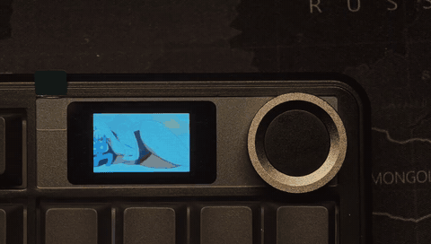
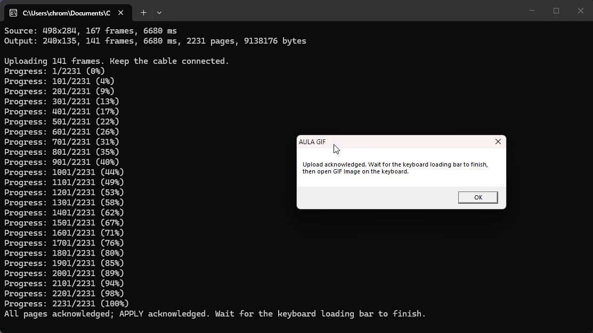

# AULA GIF

Put ordinary GIF animations on the **AULA F108 Pro** screen without installing the vendor's configuration software. Select a GIF, convert it automatically, and upload over USB.



**Tested only on the AULA F108 Pro, using Windows and a wired USB connection. No other keyboard model has been tested or is currently supported.** Contributions for other models are welcome; see [Contributing](CONTRIBUTING.md).

**Ubuntu:** [experimental source code](linux/aula_gif.py) is available for contributors. It has not been tested on real Linux hardware. No Ubuntu application/package is published in Releases.

## Downloads

Open the [Releases page](https://github.com/panasico/aula-gif/releases):

- **Windows:** `aula-gif-0.1.0-windows.zip` — extract and double-click `AulaGif.exe`. Uses the .NET Framework supplied with Windows; no separate driver installation.

## Windows quick start

1. Connect the F108 Pro with a USB cable and select **wired mode** on the keyboard.
2. Open `AulaGif.exe` and select any ordinary `.gif` file.
3. Confirm the upload. It replaces the custom animation in slot 1.
4. Keep the cable connected during the transfer **and until the keyboard's own loading indicator finishes**.
5. Select **GIF Image** on the keyboard if needed.

The app opens a console with progress and simple file/confirmation dialogs. A full 141-frame transfer can take several minutes.



Confirmed example: **498×284, 167 frames, 6.68 seconds → 240×135, 141 frames, 6.68 seconds**. The owner verified the animation playing on the keyboard after all 2231 pages were acknowledged.

## Ubuntu source — experimental, not a release

The [Ubuntu implementation](linux/aula_gif.py) is retained for development and contributions. Conversion and mock protocol tests pass, but installation, GUI, permissions and actual USB upload on Linux have **not** been validated. The maintainer is not currently planning a WSL test. Do not treat the source as a supported Ubuntu application.

For contributors running from a checkout:

```sh
sudo apt install python3 python3-pil python3-tk
python3 linux/aula_gif.py --help
python3 linux/aula_gif.py convert input.gif output-folder
```

For desktop sessions, optionally install the supplied udev rule to give the local logged-in user access to the keyboard's two vendor interfaces:

```sh
sudo cp linux/70-aula-gif.rules /etc/udev/rules.d/
sudo udevadm control --reload-rules
```

Reconnect the keyboard. This optional rule is **not installed automatically** and is itself unverified on Linux. Contributors can use the [Linux/WSL validation checklist](docs/WSL.md) to document future testing.

Linux uses existing `hidraw` support. It does not replace USB drivers, detach the keyboard driver, or use libusb. Only the F108 Pro wired USB ID `0c45:800a` and matching vendor report descriptors are accepted.

## Command line

Windows:

```powershell
.\AulaGif.exe list
.\AulaGif.exe convert "input.gif" "output-folder"
.\AulaGif.exe check "output-folder\animation.aula-rgb565"
.\AulaGif.exe upload "output-folder\animation.aula-rgb565"
```

Experimental Ubuntu source (from a checkout):

```sh
python3 linux/aula_gif.py list
python3 linux/aula_gif.py convert input.gif output-folder
python3 linux/aula_gif.py check output-folder/animation.aula-rgb565
python3 linux/aula_gif.py upload output-folder/animation.aula-rgb565
```

Linux asks for confirmation before uploading; `--yes` skips the prompt. The Windows `upload` CLI command sends immediately. Both graphical entry points ask before sending.

## Conversion and limits

- Screen: **240×135**, aspect ratio preserved with black padding.
- Color: RGB565 little-endian.
- At most **141 frames**. Longer GIFs are sampled evenly by frame index; skipped frame delays are accumulated.
- Delay resolution: **20 ms**, maximum 5.1 seconds per output frame. Very short source frame delays can lengthen playback because the display cannot represent delays below 20 ms. Long holds that cannot fit are rejected.
- Output includes `animation.aula-rgb565`, `preview.png`, `frames.csv`, and `info.txt`.
- `.aula-rgb565` is this tool's raw upload format, **not firmware and not an official AULA project file**.
- Upload errors stop immediately; partial pages are not automatically retried and APPLY is not sent after a failed page.

The 141-frame cap is a hardware protection: reverse-engineering reports found that larger writes can overwrite built-in menu graphics. Do not raise it without verified information about a different hardware model. This app supports **F108 Pro only**.

## Build and test

Windows (.NET Framework compiler, no NuGet dependencies):

```powershell
.\scripts\build-windows.ps1
.\scripts\test-windows.ps1
```

Experimental converter/protocol tests:

```sh
python3 -m unittest discover -s tests -v
```

Tests require Pillow (`python3-pil` on Ubuntu). CI runs software tests on Ubuntu and builds the Windows release. Passing these tests does not verify Linux USB or GUI behavior. The Ubuntu package builder remains a development utility only; its output is not included in Releases.

## Validation status

| Area | Status |
| --- | --- |
| Windows conversion and actual USB upload | Confirmed by owner on F108 Pro |
| RGB565 byte order, frame sizing, 141-frame cap, total duration | Automated tests |
| Linux upload sequence and failure handling | Mock transport tests |
| Ubuntu installation and GUI | Not tested; no supported release |
| Linux USB upload on real keyboard | Not tested |
| Other keyboard models | Not tested or supported; contributions welcome |

See [validation notes](docs/VALIDATION.md) for what was and was not exercised.

## Contributing

Issues and pull requests are welcome, especially hardware testing of the [experimental Ubuntu code](linux/aula_gif.py) and support for other keyboard models. Include the exact model, USB descriptors, verified display dimensions and memory/frame limit, OS version, and test results. Do not simply replace the device ID or raise the frame cap: different hardware needs its own verified profile. See [CONTRIBUTING.md](CONTRIBUTING.md).

## Protocol references

Original implementation based on the publicly documented device protocol:

- [parsiya/f108-pro — HID protocol](https://github.com/parsiya/f108-pro/blob/main/ai-docs/hid-protocol.md)
- [parsiya/f108-pro — LCD investigation](https://github.com/parsiya/f108-pro/blob/main/ai-docs/lcd-upload-investigation.md)
- [sarequl/aula-studio — hardware profile and frame limit](https://github.com/sarequl/aula-studio/blob/main/Sources/AulaKit/KeyboardProfile.swift)
- [Linux hidraw API](https://www.kernel.org/doc/html/latest/hid/hidraw.html)

Not affiliated with AULA. Software: MIT license. Demonstration media is excluded from the software license; depicted content belongs to its respective rights holders.
